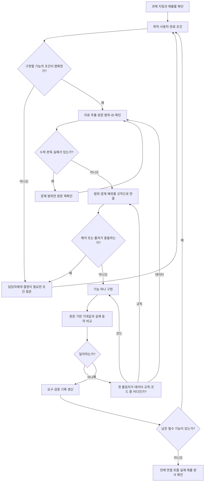

# 작업 흐름과 전달 기준

[처음으로](../README.md) · [실행 명령](TOOLS.md)

**사용자는 목적과 결정, 담당자는 업무 기준, AI는 기록·구현·검증을 맡습니다.** ID나 JSON을 사용자가 외울 필요는 없습니다. 이 문서는 일반적인 개발 작업 안내이며 실제 과제의 권한·도구·제출 제한을 변경하지 않습니다.

## 필요한 순서만 따라가기

분기는 **현재 구현할 기능**에 적용합니다. 전체 과제의 미정 사항 때문에 독립적으로 확정된 기능까지 모두 멈출 필요는 없습니다. 담당자가 답하지 않은 부분을 AI 가정으로 채우지 않습니다.

## 실제로 주고받을 것

| 단계 | 사용자가 할 짧은 요청 | AI가 보여줄 것 | 다음 단계에 남길 값 |
|---|---|---|---|
| 목적 | “누가 어떤 결정을 하게 만드는지와 제출 조건부터 정리해줘.” | 목적·필수 작업·제출물·미정 사항 | 목표와 원문 위치, 완료 조건 |
| 담당자 확인 | “구현을 바꾸는 미정 조건만 질문으로 정리해줘.” | 중요 쟁점 최대 3개, 각 답이 바꿀 기능 | 질문과 담당자 원문, 답하지 않은 부분 |
| 자료 읽기 | “필요한 자료 범위를 읽고 누락과 원문 위치를 남겨줘.” | 전체/처리 범위, 문제 ID·쪽수, 단위 | 정규화한 값 + 원래 값·위치·판독 상태 |
| 기준 적용 | “이 답변을 기존 기준과 대조하고 충돌을 분리해줘.” | 적용 대상·경계·예외·권한·출처 | 확정 규칙, 미정 정책, 의존 기능 |
| 구현 | “확정된 다음 기능 하나를 기존 기능을 유지하며 만들어줘.” | 변경 파일·기능·남은 영향 | 요구 ID, 구현 파일, 확인할 입력·기대값 |
| 검증 | “정상·거절·경계·정보 부족 중 필요한 사례를 실제로 실행해줘.” | 기대·실제·실행 로그, 첫 불일치 | 실패 입력·기대 근거·실제·오류 단계 |
| 정리 | “최신 상태와 실제 동작을 대조하고 넘겨받는 사람이 확인하게 정리해줘.” | 실행 방법·해결 범위·남은 한계 | 재현 방법과 최신 증거 위치 |

모든 행과 로그를 대화에 반복하지 않습니다. **판단을 바꾸는 원문, 달라진 요구, 실패 사례**만 먼저 보고 나머지는 허용된 로컬 기록에 둡니다. 다른 대화에는 상태 파일의 존재만 언급하지 말고 실제로 읽을 수 있는 경로를 전달합니다.

## 담당자 답변을 개발 작업으로 넘기기

사용자 요청:

> 담당자가 이렇게 답했어: [답변 원문]. 질문 중 답하지 않은 부분과 기존 기준과의 충돌을 먼저 분리해줘. 확정된 새 요구는 출처와 완료 조건을 붙여 누적하고, 영향받는 기존 기능과 검증을 표시해줘. 지금 구현할 기능 하나를 정해 진행해줘.

AI의 처리:

1. 답변을 **확정 정책 / 설계 선택 / 미답변 / 충돌**로 구분합니다. 이미 물었던 질문을 반복하기 전에 기존 답을 조회합니다.
2. 기존 요구를 유지하고 바뀐 부분만 갱신합니다. 범위 축소도 삭제가 아니라 결정 근거와 이력으로 남깁니다.
3. 변경된 정책에 의존하는 기능·검사를 연결합니다. 낡은 통과 기록은 현 버전의 완료 근거로 쓰지 않습니다.
4. 관련 기능을 구현·검증하고 실제 상태에서 짧은 현황을 출력합니다.

## 사람은 이 세 부분만 먼저 확인

| 확인 지점 | 이상이 없으면 | 이상이 있으면 다음 요청 |
|---|---|---|
| 목표·기준: 담당자 답을 반대로 읽거나 조건을 더했는가? | 다음 기능 진행 | “이 원문과 방금 기준이 달라. 달라진 조건과 의존 기능을 확인하고 기준부터 수정해줘.” |
| 자료: 범위·ID·단위·판독 실패가 드러나는가? | 규칙 적용 결과 확인 | “누락·미확인 범위만 다시 읽고 원문값과 추출값을 나란히 보여줘.” |
| 동작: 기대·실제·저장 후 결과가 맞는가? | 상태 갱신 | “입력, 기대 근거, 실제 결과, 첫 불일치 단계만 보여줘. 원인 하나씩 고쳐줘.” |

특히 상태 변경 기능은 **변경 → 후보·집계 재계산 → 다음 행동 안내 → 저장 후 재열람**까지 봅니다. 목록 필터가 전체 대상의 업무 배분을 바꾸지 않는지도 해당 요구가 있을 때 확인합니다. 읽기 전용 과제에 불필요한 저장 기능을 추가하지 않습니다.

## 기능별 현황을 함께 보고 싶을 때

개발 중간·유지보수 시작·결과 전달 전에는 `fde-project-review`로 현재 기능과 데이터를 연결해 읽습니다. 개별 작업의 짧은 상태 표시를 전체 리뷰로 매번 대체하지 않습니다.

> 현재 솔루션을 읽기 전용으로 점검해줘. 기능마다 읽는 데이터, 처리 기준·중복·예외, 실제 검증 근거, 출력과 후속 영향, 남은 확인을 연결해줘.

사용자는 코드 확인과 실제 실행이 구분됐는지, 요청했던 미완료 기능이 빠지지 않았는지, 출력이 다음 동작에 미치는 영향이 설명됐는지를 봅니다. 리뷰에서 발견한 문제는 별도 수정·재검증 작업으로 넘깁니다. 단순 리뷰에서는 기록 초기화·상태 갱신·테스트 실행을 자동으로 시작하지 않습니다.

구체적인 항목은 [리뷰 스킬](../skills/fde-project-review/SKILL.md)과 [출력 형식](../skills/fde-project-review/references/review-format.md)에 있습니다.

## 재개·모델 변경·설치 실패

- 기존 manifest가 있으면 실제 package·guide·progress 경로를 읽습니다. 없으면 현재 키트 경로와 존재하는 기록을 사용합니다.
- 목표·요구·검사의 기준 기록은 `FDE_PROGRESS.json`입니다. `FDE_WORKSTATE.md`는 요약이며 없을 수도 있습니다. 대화 원문은 이 도구가 자동 저장하지 않습니다.
- 새 대화는 상태·관련 원문·현재 변경 파일을 먼저 읽고 마지막 검사 이후의 변경을 확인합니다. 전체 자료를 매번 다시 읽거나 기록을 초기화하지 않습니다.
- 설치 도중 권한 오류가 났다면 원본 설치 계획과 실제 생성 파일을 대조합니다. 내용이 같은 파일·누락 파일·불일치 파일을 나누고, 자동 재설치나 임의 삭제로 해결하지 않습니다. 설치 없이 읽는 방식으로 전환할 수 있습니다.
- 기록 쓰기가 금지되면 “미저장”을 표시하고 목표 / 확정 기준·출처 / 기존 요청 / 미완료·미검증 / 다음 행동을 짧게 전달합니다. 저장되지 않은 내용을 다음 대화가 기억한다고 약속하지 않습니다.

## 도구를 추가할지 결정

현재 도구로 재현 가능한 작업이면 추가하지 않습니다. 부족하면 **실제 지원하는 기능 → 설치·외부 전송 허용 여부 → 라이선스·버전 → 최소 실행 확인 → 실패 시 기본 경로**를 확인합니다. MCP·스킬·플러그인은 서로 대체 가능한 이름이 아니며 스킬 문서만으로 서버나 권한이 생기지 않습니다.
